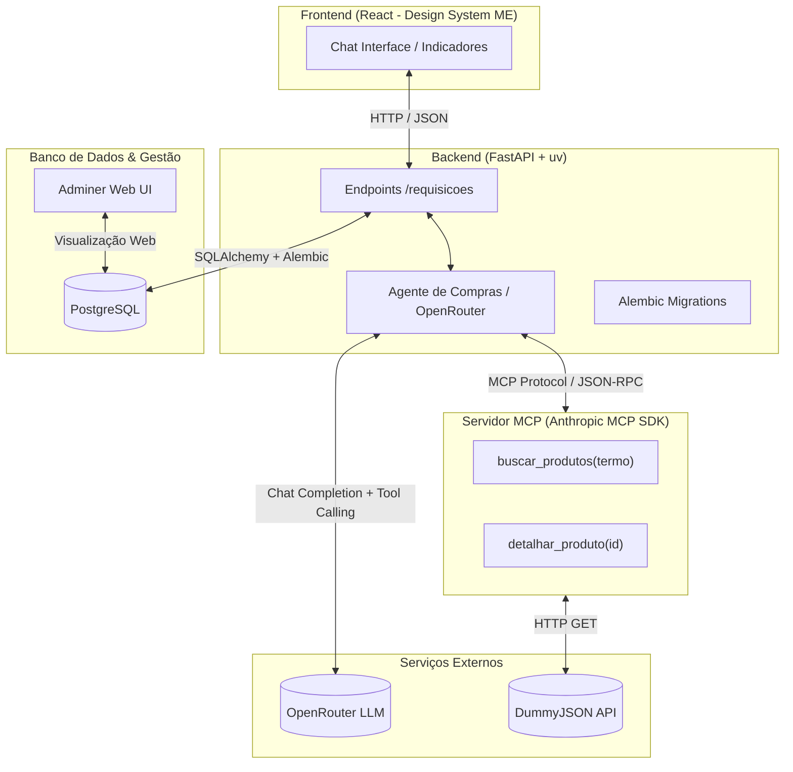
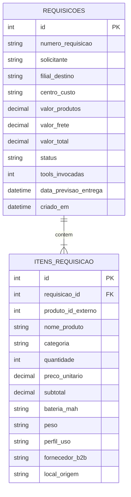

# 🏛️ Arquitetura do Sistema

> **Projeto:** Piloto ME Genius — Agente de Compras Autônomo  
> **Cenário:** Case AI FDE (Mercado Eletrônico / Grupo 3 Corações)

---

## 1. Visão Geral da Arquitetura

O ecossistema é orquestrado via `docker compose` com serviços desacoplados e ferramentas de apoio à gestão dos dados:



---

## 2. Stack Tecnológica & Identidade Visual

| Componente | Tecnologia | Papel |
| :--- | :--- | :--- |
| **Frontend** | React (Vite) | Interface de chat inspirada na identidade oficial do portal ME (`LoginNew`), com métricas e cards técnicos. |
| **Backend** | Python + FastAPI + **uv** | Gerenciamento ultrarrápido com `uv`, API REST (`POST /requisicoes`, `GET /requisicoes`) e orquestração do agente. |
| **Banco de Dados** | PostgreSQL 16 + SQLAlchemy | Criação automática das tabelas no startup do backend (`Base.metadata.create_all`). |
| **Servidor MCP** | Anthropic Python `mcp` SDK | Servidor isolado que expõe `buscar_produtos` e `detalhar_produto` consumindo a DummyJSON. |
| **LLM Provider** | OpenRouter API | Modelo com capacidade nativa de *Tool Calling* / *Function Calling*. |
| **Banco de Dados** | PostgreSQL 16 | Armazenamento relacional das requisições corporativas e seus itens. |
| **Visualizador de Banco** | Adminer | Interface web leve para inspecionar tabelas, requisições e itens salvos no PostgreSQL. |
| **Orquestração** | Docker & Docker Compose | Inicialização dos serviços em rede isolada com `docker compose up`. |
| **Automação** | Makefile | Atalhos práticos de setup, build, migrations e logs. |

---

## 3. Design System do Frontend (Inspirado no Portal ME)

O layout do chat adota o padrão visual oficial do portal Mercado Eletrônico (`LoginNew`):

- **Paleta de Cores:**
  - Azul Institucional ME: `#1052e0` (primário) e `#0a8ccc` (destaques/links)
  - Verde de Sucesso / Aprovação: `#2bb46a` (confirmação da requisição)
  - Fundo Neutro Corporativo: `#f8f9fa` (área de trabalho) e `#ffffff` (cards/painéis)
  - Textos e Títulos: `#343a40` (alto contraste e legibilidade)
  - Alerta Orçamentário: `#ff5f5f` (trava/aviso quando excede o limite de US$ 2.000)
- **Tipografia:** `Source Sans Pro`, `Roboto`, `Open Sans`
- **Layout:**
  - Barra superior institucional com logo **Mercado Eletrônico** + **ME Genius** e identificação do cliente (**Grupo 3 Corações**).
  - Janela de chat estilo B2B SaaS, com balões claros, chips de status, contador de tools e card expansível com ficha técnica do produto e detalhes logísticos.

---

## 4. Modelo de Dados (PostgreSQL + Alembic)

Refletindo os requisitos levantados no discovery com a 3 Corações:



---

## 5. Fluxo de Execução Ponta a Ponta

1. **Entrada do Solicitante:**  
   Mariana envia no chat: *"Preciso de 3 laptops para o time de vendas, até US$ 2.000 cada."*
2. **Recepção no Backend:**  
   O FastAPI recebe a requisição em `POST /requisicoes` e inicia a sessão do agente com o histórico e as definições das ferramentas MCP.
3. **Consulta ao LLM & Tool Calling:**  
   O modelo (OpenRouter) decide autonomamente chamar `buscar_produtos(termo="laptop")`.
4. **Execução no Servidor MCP:**  
   O servidor MCP recebe a chamada via protocolo JSON-RPC, dispara `GET https://dummyjson.com/products/search?q=laptop` e retorna a lista de produtos reais para o agente.
5. **Decisão & Grounding:**  
   O modelo avalia preços, especificações (bateria, peso, uso) e descarta itens acima de US$ 2.000.  
   - Se encontrar: seleciona o item compatível, calcula os totais (3 unidades) e monta a requisição estruturada.
   - Se a DummyJSON falhar ou não houver item adequado: recusa e explica a pendência sem alucinar.
6. **Persistência Relacional:**  
   O backend grava a requisição e seus itens no PostgreSQL via SQLAlchemy e Alembic.
7. **Resposta ao Frontend & Consulta via Adminer:**  
   O chat exibe a mensagem de confirmação com número da requisição, detalhes técnicos, frete/prazo e contador de tools executadas. Os dados gravados podem ser inspecionados diretamente na interface web do Adminer.

---

## 6. Estrutura de Pastas do Repositório

```text
.
├── Makefile                     # Atalhos de execução, build e migrations
├── docker-compose.yml           # Orquestração dos containers (incluindo Adminer)
├── .env.example                 # Variáveis de ambiente padrão
│
├── backend/                     # API FastAPI + uv
│   ├── app/
│   │   ├── agent/               # Loop do agente e cliente MCP
│   │   ├── api/                 # Rotas (POST/GET /requisicoes)
│   │   ├── db/                  # Sessão SQLAlchemy e base
│   │   ├── models/              # Modelos do banco (Requisicao, Item)
│   │   └── schemas/             # Schemas Pydantic
│   ├── alembic/                 # Migrações versionadas
│   ├── alembic.ini
│   ├── pyproject.toml           # Dependências gerenciadas via uv
│   └── Dockerfile
│
├── mcp_server/                  # Servidor MCP com SDK Anthropic
│   ├── server.py                # Tools: buscar_produtos e detalhar_produto
│   └── Dockerfile
│
├── frontend/                    # Interface React (Identidade Visual ME)
│   ├── src/
│   │   ├── components/          # Chat, Cards de Produto, Indicadores
│   │   └── App.jsx
│   ├── Dockerfile
│   └── package.json
│
└── docs/
    ├── CONTEXTO_CLIENTE.md      # Discovery e regras levantadas no cliente
    └── ARQUITETURA.md           # Este documento
```

---

## 7. Comandos do Makefile

- `make up`: Sobe todos os serviços via Docker Compose com build.
- `make down`: Encerra e remove os containers.
- `make migrate`: Aplica as migrações do Alembic no PostgreSQL.
- `make logs`: Acompanha os logs integrados dos containers.
