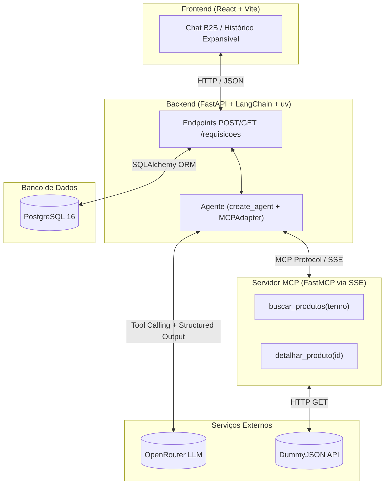
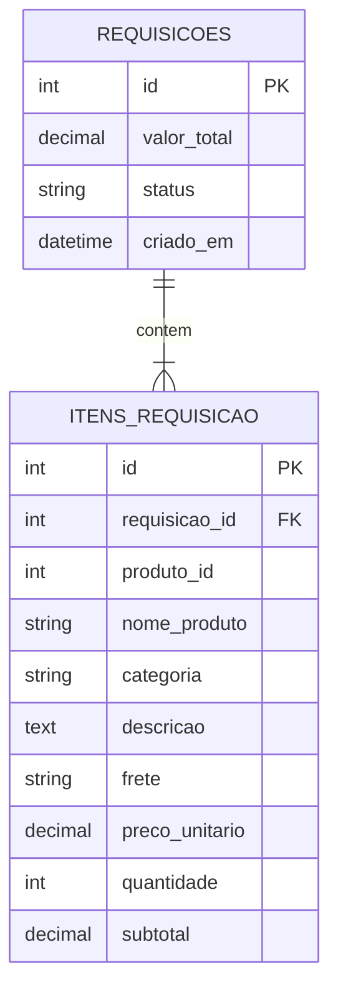

# 🏛️ Arquitetura do Sistema

> **Projeto:** ME Genius — Agente de Compras B2B Autônomo  
> **Cenário:** Case AI Forward Deployed Engineer (Mercado Eletrônico)

---

## 1. Visão Geral da Arquitetura

O ecossistema é orquestrado via `docker compose` com quatro serviços desacoplados:



---

## 2. Stack Tecnológica

| Componente | Tecnologia | Papel |
| :--- | :--- | :--- |
| **Frontend** | React 19 + Vite | Interface B2B baseada na identidade oficial de `institucional.me.com.br`, com chat e histórico expansível. |
| **Backend** | Python + FastAPI + **uv** | API REST (`POST /requisicoes`, `GET /requisicoes`), persistência relacional e orquestração do agente. |
| **Agente & MCP Client** | `langchain[mcp]` + `langchain-openai` | Descoberta dinâmica de tools via `MCPAdapter` e loop de tool calling via `create_agent` + `response_format`. |
| **Servidor MCP** | Python `mcp` SDK (`FastMCP`) | Servidor isolado via transporte SSE que expõe `buscar_produtos` e `detalhar_produto` consumindo a DummyJSON. |
| **LLM Provider** | OpenRouter API | Modelo com suporte a *Tool Calling* e *Structured Output*. |
| **Banco de Dados** | PostgreSQL 16 + SQLAlchemy | Armazenamento relacional das requisições e seus itens com criação automática no startup (`lifespan`). |
| **Orquestração** | Docker Compose & Makefile | Inicialização dos 4 containers em rede isolada com hot reload e atalhos de automação. |

---

## 3. Identidade Visual do Frontend (`institucional.me.com.br`)

Extraída diretamente da folha de estilos e ativos oficiais do portal institucional do Mercado Eletrônico:

- **Paleta de Cores:**
  - Azul Institucional Primário: `#0A0A93`
  - Ciano Secundário: `#08BFE0`
  - Verde-lima Destaque / Status: `#BDE44E`
  - Texto Escuro: `#252F39`
  - Superfícies e Fundos: `#F8F8F8`, `#F2F2F2` e `#FFFFFF`
  - Alerta / Erro: `#CF2E2E`
- **Tipografia:** `Montserrat` (principal), `Poppins` (destaques/botões) e `JetBrains Mono` (valores monetários e códigos de requisição).
- **Layout:**
  - Header institucional com o logo vetorial oficial `me.` em SVG.
  - Painel principal de conversação com envio de histórico de mensagens e renderização de cards de requisição (`REQ #0001`).
  - Coluna lateral de histórico em tempo real com cards clicáveis/expansíveis (dropdown).

---

## 4. Modelo de Dados (PostgreSQL + SQLAlchemy)



---

## 5. Fluxo de Execução Ponta a Ponta

1. **Entrada no Chat:**  
   O solicitante envia uma consulta ou pedido no chat (acompanhado do histórico da conversa).
2. **Recepção no Backend (`POST /requisicoes`):**  
   O FastAPI recebe o payload e aciona `executar_agente(mensagem, historico)`.
3. **Descoberta MCP & Classificação de Intenção:**  
   O agente (em cache com as tools carregadas via `MCPAdapter`) classifica a intenção (Pesquisa, Pedido de Compra, Pedido Incompleto ou Fora de Escopo) e decide autonomamente quando invocar `buscar_produtos` e `detalhar_produto`.
4. **Execução no Servidor MCP:**  
   O container `mcp_server` consulta a API DummyJSON (`https://dummyjson.com/products`) com timeout e tratamento resiliente de falhas HTTP.
5. **Saída Estruturada (`DecisaoAgente`):**  
   Ao finalizar o loop, o agente retorna um objeto Pydantic validado (`mensagem` em português e lista `itens` em `US$` com o prazo de `frete` traduzido de `shippingInformation`).
6. **Persistência Determinística:**  
   Se a decisão contiver itens aprovados para compra, a rota FastAPI calcula os subtotais e o valor total de forma determinística e grava a `Requisicao` e seus `ItemRequisicao` no PostgreSQL.
7. **Exibição no Frontend:**  
   O chat renderiza a resposta e o card da requisição criada, atualizando simultaneamente a lista lateral de histórico (`GET /requisicoes`).

---

## 6. Estrutura de Pastas do Repositório

```text
.
├── Makefile                     # Atalhos de execução, build, logs e testes
├── docker-compose.yaml          # Orquestração dos 4 containers (postgres, mcp_server, backend, frontend)
├── .env.example                 # Ponto central de variáveis de ambiente
├── README.md                    # Guia rápido de execução e decisões técnicas
│
├── backend/                     # API FastAPI + Agente LangChain
│   ├── app/
│   │   ├── agent/
│   │   │   └── runner.py        # Agente create_agent + MCPAdapter + OpenRouter
│   │   ├── api/
│   │   │   └── requisicoes.py   # Endpoints POST/GET /requisicoes
│   │   ├── db/
│   │   │   └── session.py       # Engine, SessionLocal e Base SQLAlchemy
│   │   ├── models/
│   │   │   └── requisicao.py    # Tabelas Requisicao e ItemRequisicao
│   │   ├── schemas/
│   │   │   └── requisicao.py    # Schemas Pydantic de entrada, decisão e saída
│   │   └── main.py              # Inicialização FastAPI, CORS e criação de tabelas
│   ├── tests/
│   │   └── test_pedidos.py      # Suíte pytest com 5 pedidos de teste do agente
│   ├── requirements.txt
│   └── Dockerfile
│
├── mcp_server/                  # Servidor MCP isolado (FastMCP via SSE)
│   ├── server.py                # Tools: buscar_produtos e detalhar_produto
│   ├── tests/
│   │   └── test_server.py       # Testes das tools do MCP (sem chave de LLM)
│   ├── pytest.ini
│   ├── requirements.txt
│   └── Dockerfile
│
├── frontend/                    # Interface React + Vite (Identidade Visual ME)
│   ├── src/
│   │   ├── components/
│   │   │   └── RequisitionCard.jsx
│   │   ├── App.jsx
│   │   ├── index.css
│   │   └── main.jsx
│   ├── index.html
│   ├── vite.config.js
│   ├── package.json
│   └── Dockerfile
│
└── docs/
    ├── CONTEXTO_CLIENTE.md      # Simulação de discovery com o cliente
    ├── ARQUITETURA.md           # Este documento
    └── MELHORIAS.md             # Roadmap de evoluções para produção
```

---

## 7. Comandos do Makefile

- `make up`: Sobe todos os serviços em background com build (`docker compose up --build -d`).
- `make down`: Encerra e remove os containers, órfãos e volumes (`docker compose down -v --remove-orphans`).
- `make logs`: Acompanha os logs integrados em tempo real (`docker compose logs -f`).
- `make test`: Executa as suítes de testes do `mcp_server` e dos 5 pedidos do `backend` via `pytest`.
